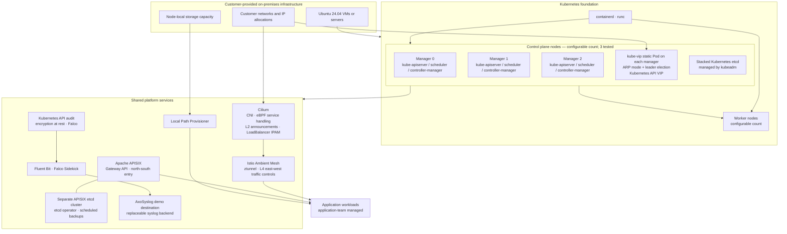
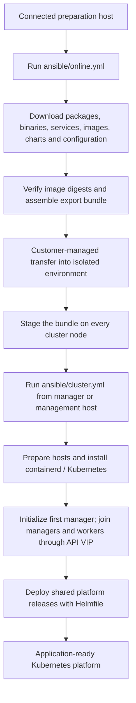

# Base Kubernetes Platform

An Ansible-driven, air-gapped Kubernetes platform reference implementation for customer-provided on-premises infrastructure.

This project turns existing Ubuntu servers or virtual machines into a Kubernetes platform with foundational networking, service-mesh, gateway, storage, security, and log-forwarding capabilities. It is designed for environments where the customer owns the infrastructure and network, and the platform operator is responsible for installing and configuring Kubernetes and its shared services.

The repository is both a working implementation and an adaptable engineering reference. It does not provision virtual machines, depend on a particular hypervisor, or provide a complete managed Kubernetes distribution.

> **Project status:** The platform has been tested on virtual machines with a three-node control plane. The control-plane count and worker membership are configurable. Physical-server deployments and customer-specific network designs should be validated independently. This is a reference implementation, not a claim of production readiness for every environment.

## Contents

- [Goals and scope](#goals-and-scope)
- [Architecture](#architecture)
- [Technology stack](#technology-stack)
- [High availability and cluster lifecycle](#high-availability-and-cluster-lifecycle)
- [Air-gapped deployment model](#air-gapped-deployment-model)
- [Prerequisites](#prerequisites)
- [Configuration](#configuration)
- [Deployment](#deployment)
- [Platform components](#platform-components)
- [Secrets and security](#secrets-and-security)
- [Logging and observability](#logging-and-observability)
- [Application team responsibilities](#application-team-responsibilities)
- [Repository layout](#repository-layout)
- [Validation](#validation)
- [Limitations and operational considerations](#limitations-and-operational-considerations)
- [Roadmap](#roadmap)
- [License](#license)

## Goals and scope

The platform is intended for on-premises environments where the customer provides and administers the underlying infrastructure, while the platform operator installs and configures Kubernetes and its foundational services.

The main design goals are:

- **On-premises first:** deploy onto customer-provided virtual machines or servers without depending on a particular hypervisor or cloud provider.
- **Air-gapped installation:** prepare required operating-system packages, binaries, container images, charts, and supporting files on a connected host, then transfer them into the isolated environment before deployment.
- **Infrastructure-aware configuration:** let the infrastructure administrator provide node addresses, network interfaces, CIDR ranges, VIPs, and other environment-specific values.
- **Minimal external dependencies:** avoid requiring an internal container registry, a cloud control plane, or a customer-managed package repository for the deployment workflow.
- **Reusable automation:** use Ansible for host and Kubernetes lifecycle tasks, and Helmfile to coordinate platform chart releases and their dependencies.
- **Clear ownership boundaries:** provide shared cluster capabilities while leaving application-specific deployment and lifecycle management to application teams.

### What this project does

The project automates:

1. Online preparation and packaging of the dependencies needed for an offline installation.
2. Host preparation and local package installation on the target nodes.
3. Container runtime installation and configuration.
4. Kubernetes installation and initialization with `kubeadm`.
5. A multi-control-plane topology with a stable Kubernetes API VIP.
6. Deployment of the shared platform services through Helmfile.

### What this project does not do

The customer remains responsible for supplying the compute, network, IP allocations, and storage capacity. The project does not provision VMs, configure hypervisors, allocate customer networks, or manage the physical infrastructure lifecycle. It also does not deploy or operate application-specific workloads.

## Overview


## Architecture

The platform has three main layers:

1. **Customer infrastructure:** VMs or physical servers, network connectivity, IP allocations, and node-local storage capacity.
2. **Kubernetes foundation:** kubeadm-managed control-plane and worker nodes, containerd, kube-vip, and Cilium.
3. **Shared platform services:** Istio Ambient Mesh, Apache APISIX, APISIX's dedicated etcd cluster, Local Path Provisioner, Falco, and log forwarding.

### Logical architecture



The diagram is a logical overview, not a packet-level topology. Actual traffic paths depend on workload enrollment and the corresponding Istio and Gateway API configuration. Control-plane nodes are reserved for Kubernetes control-plane services and platform controllers/operators; application workloads are placed on workers. Required DaemonSets, such as Cilium and Istio components, still run on the nodes selected by their DaemonSet configuration.

### API VIP and service LoadBalancer addresses are separate

The project uses two distinct mechanisms for two different purposes:

- **kube-vip** provides the Kubernetes API endpoint VIP. It runs as a static Pod on every control-plane node and uses ARP mode with leader election. The active instance advertises the VIP. If that instance becomes unavailable, another kube-vip instance can acquire the lease and advertise the same address.
- **Cilium LoadBalancer IPAM and L2 announcements** allocate and advertise addresses for Kubernetes `LoadBalancer` services from a customer-reserved address pool.

The kube-vip address is not the Cilium service LoadBalancer pool. kube-vip is used for Kubernetes API access; Cilium handles service exposure on the customer network.

The configured VIP must be available on the selected interface and on a network where the control-plane nodes can participate in the required ARP announcements. Validate the VIP, interface, and Layer-2 network with the infrastructure administrator before deployment.

### Network and traffic responsibilities

- **Cilium** provides pod networking, eBPF-based service handling, kube-proxy replacement in the configured restricted mode, and Kubernetes `LoadBalancer` IP allocation. L2 announcements advertise allocated service addresses on the customer network.
- **Istio Ambient Mesh** provides the east-west service-mesh data plane using `ztunnel`. The current implementation uses the Ambient L4 data plane; it does not claim to provide L7 waypoint functionality.
- **Apache APISIX** provides the north-south gateway and exposes applications through Kubernetes Gateway API resources such as `Gateway` and `HTTPRoute`.
- **APISIX etcd** is a separate etcd cluster managed by an etcd operator. It is not the Kubernetes control-plane etcd cluster.

APISIX and its Gateway API controller are enrolled in Ambient Mesh. Application namespaces/workloads should also be enrolled when mesh controls are required. When both sides participate in the mesh, APISIX-to-workload traffic can be governed by the Ambient data plane and applicable policies. Routing to workloads outside the mesh bypasses those mesh-level controls and is not the intended secure deployment model.

## Technology stack

| Area | Technology |
|---|---|
| Host and cluster automation | Ansible |
| Kubernetes bootstrap and lifecycle | Kubernetes, kubeadm |
| API VIP and failover | kube-vip, ARP mode, leader election |
| Container runtime | containerd, runc |
| Container tooling | nerdctl, crictl |
| Kubernetes networking | Cilium |
| Service mesh | Istio Ambient Mesh, ztunnel, Istio CNI |
| Gateway and ingress | Apache APISIX, Kubernetes Gateway API |
| APISIX state store | Dedicated etcd cluster, etcd operator |
| Package and release orchestration | Helm, Helmfile |
| Local persistent volumes | Local Path Provisioner |
| Secret encryption for deployment inputs | Mozilla SOPS, age |
| Runtime threat detection | Falco |
| Log forwarding | Fluent Bit, Falco Sidekick |
| Log destination | AxoSyslog (demonstration configuration) |
| Cluster CLI | kubectl, k9s |

Versions are maintained in Ansible variables, artifact definitions, image references, Helmfile releases, and chart values. Consult those files for the exact versions used by a particular repository revision.

## High availability and cluster lifecycle

### Control plane

The implementation supports multiple control-plane nodes. The number of managers is configured through the Ansible inventory; the reference deployment has been tested with three control-plane nodes. The Ansible workflow:

1. Initializes the first manager.
2. Configures the kube-vip static Pod on control-plane nodes.
3. Joins subsequent managers sequentially through the API VIP.
4. Joins workers through the same API VIP.

Both control-plane and worker `kubeadm` join operations use the VIP as the stable Kubernetes API endpoint. The VIP is also configured as the cluster's `controlPlaneEndpoint`; node-specific addresses remain associated with their respective hosts.

Kubernetes etcd uses the kubeadm **stacked etcd** topology, with an etcd member on each control-plane node. This is separate from the etcd cluster used by APISIX.

The implementation has been tested both with an initial multi-control-plane deployment and with adding a control-plane node to an existing cluster. Worker membership can be extended by adding hosts to the inventory and running the cluster playbook.

### kube-vip behavior

Each control-plane node runs kube-vip as a static Pod. ARP mode and leader election ensure that only the current leader advertises the API VIP. When the current leader becomes unavailable, another participating instance can acquire the lease and take over advertisement of the VIP.

The VIP is for the Kubernetes API only. It does not provide application ingress or replace Cilium's `LoadBalancer` implementation.

### Redeployment behavior

The Ansible tasks include checks intended to avoid reinitializing an already initialized control plane or rejoining nodes that already have their kubelet configuration. Helmfile reconciles the declared platform releases. These behaviors support repeatable execution for the deployment paths covered by the checks.

Repeatability should not be interpreted as a guarantee that every upgrade, rollback, configuration change, or partial-failure recovery is automatically safe. Validate changes and recovery procedures in a representative environment before applying them to important workloads.

## Air-gapped deployment model

Deployment has two distinct phases.

### 1. Online preparation

Run the online preparation playbook on a connected host with access to the required upstream package repositories, chart repositories, and container registries:

```bash
cd ansible
ansible-playbook -i inventory.yml online.yml
```

The preparation workflow retrieves and prepares the dependencies required by the selected project configuration, including:

- Ubuntu APT packages used for offline host setup.
- Supporting binaries, tools, and system services.
- Container images.
- Helm charts and chart-related configuration.
- Supporting configuration and security artifacts, including kube-vip, SOPS, and age dependencies.

Container images are retrieved using their configured SHA-256 digests, verified during the online preparation phase, tagged with the expected image references, and archived for offline import. The workflow does not require an internal image registry in the disconnected environment; images are imported directly into containerd on the target nodes using `nerdctl`.

The archive task collects the prepared artifacts into an export bundle. The bundle includes the artifact groups required by the host preparation and platform deployment workflows.

### 2. Transfer and offline installation

Transfer the generated bundle into the isolated environment using the customer's approved process, such as removable media or another controlled transfer mechanism. The transfer mechanism itself is outside the scope of this repository.

The required artifact bundle must be made available at the configured import path on every cluster node. The path is configurable, but it must be consistent with the Ansible configuration. Each node unpacks and uses its local copy of the artifacts; images are imported into that node's containerd image store.

Ansible can run on either:

- A control-plane node, or
- A separate management VM/server in the isolated environment.

The Ansible execution host needs SSH connectivity to all target nodes. The target nodes need network connectivity to one another on the ports required by Kubernetes and the deployed platform services. No internet access is required during the offline installation phase.

Run the cluster deployment playbook:

```bash
cd ansible
ansible-playbook -i inventory.yml cluster.yml
```

The playbook configures common node foundations, installs container runtime and Kubernetes components, initializes or joins the control plane and workers, applies the cluster security configuration, and invokes Helmfile for platform release deployment.

### Deployment workflow



### Artifact integrity

Image digests are verified during online preparation. The current workflow does not generate a separate checksum manifest for the exported transfer bundle. Use the customer's approved integrity-verification process for the bundle itself when required.

## Prerequisites

### Operating system and automation

- **Ubuntu 24.04 LTS** on all target cluster nodes. This is a hard requirement for the current implementation because operating-system package installation and updates use the prepared offline APT artifacts.
- **Ansible** on the execution host. The execution host may be one of the control-plane nodes or a separate management machine.
- SSH access with the required privilege-escalation permissions from the Ansible execution host to all cluster nodes.

### Infrastructure and network

The customer or infrastructure administrator must provide:

- One or more control-plane nodes. Three control-plane nodes have been tested.
- One or more worker nodes. Worker membership can be extended through inventory.
- Network connectivity between nodes on the ports required by Kubernetes and the deployed platform components.
- Node IP addresses, interface details, and SSH access information.
- A reserved Kubernetes API VIP on a suitable network for kube-vip ARP announcements.
- Non-overlapping Pod and Service CIDR allocations.
- A customer-reserved address range for Cilium `LoadBalancer` services.
- Node-local storage capacity for Local Path Provisioner, if it is used.

The current implementation has been tested on virtual machines. It is designed not to depend on a specific hypervisor, but deployments on physical servers or other environments should be validated.

### Network interface model

The project supports both single-NIC and dual-NIC node layouts:

- In a **dual-NIC** environment, the administrator configures the interfaces and addresses for administration and internal cluster communication. The internal node addresses are used where cluster-to-cluster communication is required; the API VIP is bound to the interface selected for kube-vip.
- In a **single-NIC** environment, the same interface can be configured for administrative access and cluster communication.

Interface names and IP addresses are environment-specific. Do not copy the example interface names or IP addresses from the repository into another environment without validating them.

## Configuration

Environment-specific settings are maintained in Ansible inventory and project defaults, primarily under `ansible/defaults/` and `ansible/vars/`. Update them for each customer environment rather than treating lab values as universal defaults.

At a minimum, review:

| Configuration area | Responsibility |
|---|---|
| Inventory hosts and groups | Define the initial manager, joining managers, workers, and Ansible connection details |
| Node addresses | Set management and internal addresses supplied by the infrastructure administrator |
| Network interfaces | Select interfaces for node communication, Cilium, and the kube-vip API VIP |
| Control-plane membership | Define the initial manager and the additional managers to join |
| API endpoint | Set the API VIP, interface, and API port |
| Pod CIDR | Choose a non-overlapping pod address range |
| Service CIDR | Choose a non-overlapping Kubernetes Service address range |
| Cilium LoadBalancer pool | Set the customer-reserved service address range |
| Storage node | Select the worker used for local-path storage |
| Artifact paths | Configure where the bundle is imported, extracted, and used |
| Secret paths | Configure the staged SOPS/age inputs required during cluster initialization and manager joins |

### Inventory structure

The inventory separates the initial control-plane node from managers that join it, and keeps worker membership independently configurable. A simplified example is:

```yaml
all:
  children:
    machines:
      children:
        cluster:
          children:
            managers:
              children:
                initial_manager:
                  hosts:
                    manager0:
                      ansible_host: <management-address>
                      internal_ip: <node-address>
                joining_managers:
                  hosts:
                    manager1:
                      ansible_host: <management-address>
                      internal_ip: <node-address>
                    manager2:
                      ansible_host: <management-address>
                      internal_ip: <node-address>
            workers:
              hosts:
                worker1:
                  ansible_host: <management-address>
                  internal_ip: <node-address>
                  node_type: storage
                worker2:
                  ansible_host: <management-address>
                  internal_ip: <node-address>
```

This is a structural example, not a complete inventory. Add or remove manager and worker hosts according to the target topology. Keep credentials out of the tracked inventory; use SSH keys, Ansible Vault, or an approved credential-injection method.

### Important defaults

The following values are examples of the settings that must be reviewed in `ansible/defaults/main.yml`:

```yaml
cluster:
  api_server:
    vip: <customer-reserved-api-vip>
    interface: <interface-for-api-vip>
    port: 6443
  networking:
    pod_cidr: <non-overlapping-pod-cidr>
    service_cidr: <non-overlapping-service-cidr>

cilium:
  load_balancer:
    pool:
      start: <reserved-service-ip-start>
      stop: <reserved-service-ip-end>
```

The configured VIP is used as the stable API endpoint by kubeadm and by Cilium. Both worker and additional control-plane nodes join through this endpoint. Certificate SAN configuration includes the control-plane node addresses and API VIP.

The Cilium LoadBalancer pool must use addresses reserved for Kubernetes services on the customer network. Do not reuse the API VIP or addresses already allocated to other infrastructure services.

## Deployment

The expected deployment sequence is:

1. Prepare the connected online host and run `ansible/online.yml`.
2. Transfer the exported artifacts into the isolated environment.
3. Place the artifact bundle on every target node at the configured import location.
4. Transport the required SOPS/age secret material to the control-plane nodes using the customer's approved process.
5. Review inventory and defaults for the target environment.
6. Run `ansible/cluster.yml` from the selected Ansible execution host.
7. Validate node readiness and platform releases.

The cluster playbook imports the following stages:

1. Common configuration for all cluster nodes.
2. Manager/control-plane configuration.
3. Worker configuration and cluster joining.
4. Platform runtime/deployment tasks.

The common node stage prepares the host, unpacks artifacts, configures local package installation, and installs the container runtime and Kubernetes components. The manager stage installs the required cluster tooling and initializes or joins Kubernetes. The worker stage joins worker nodes. The platform deployment stage runs Helmfile to reconcile the shared platform releases and their declared dependencies.

Ansible is responsible for host and cluster lifecycle tasks. It does not encode the dependency graph for every platform chart; Helmfile owns platform release ordering and reconciliation.

## Platform components

### Cilium

Cilium provides the Kubernetes CNI and eBPF-based service handling. The current configuration includes:

- Cluster-pool IPv4 IPAM using the configured Pod CIDR.
- kube-proxy replacement in the configured restricted mode.
- L2 announcements.
- A customer-defined `CiliumLoadBalancerIPPool`.
- Explicit device and direct-routing interface configuration.

Cilium is responsible for Kubernetes service `LoadBalancer` address allocation. The address pool must be reserved by the customer. Cilium Network Policies are not currently configured by this project.

### Istio Ambient Mesh

Istio is deployed using Ambient Mesh components, including `istiod`, `ztunnel`, and the Istio CNI integration.

Ambient Mesh provides the east-west workload traffic foundation. The current implementation uses the ztunnel L4 data plane. Application namespaces must be enrolled to receive the intended mesh behavior and policy enforcement. The platform provides the mesh foundation; application teams remain responsible for application-specific policy requirements in coordination with the platform operator.

APISIX and its Gateway API controller are also enrolled in the mesh. Application workloads that require mesh-level controls should be enrolled as well. Workloads outside the mesh do not receive those mesh controls.

### Apache APISIX and Gateway API

APISIX provides the north-south gateway layer. Kubernetes Gateway API resources define gateway and route configuration, including host-based application exposure.

The APISIX deployment uses a separately managed etcd cluster. The repository includes custom Helm charts and release definitions for APISIX namespace setup, the etcd cluster, and Gateway API resources. The etcd operator manages the APISIX etcd cluster and its scheduled backups.

APISIX and its controller are enrolled in Ambient Mesh. When application workloads are also enrolled, gateway-to-workload traffic can pass through the intended mesh data plane and applicable policies. Direct routing to workloads outside the mesh bypasses those controls.

### Storage

The platform deploys Local Path Provisioner as a basic node-local persistent-volume option. The designated storage worker and local storage path are configurable. `worker1` is only the current test-lab choice, not a fixed requirement.

Local Path Provisioner is not distributed storage. It does not provide replication, shared storage across nodes, or a complete backup and disaster-recovery solution. Customers must provide an appropriate storage architecture and define their own backup, snapshot, retention, and recovery policies for important data.

### Kubernetes security baseline

The current baseline includes:

- Kubernetes API audit logging.
- Kubernetes API encryption at rest for Kubernetes Secrets.
- Falco runtime detection using upstream rules.
- Istio Ambient Mesh as the foundation for workload traffic controls.
- SOPS/age-encrypted deployment inputs, decrypted at runtime by Ansible.

These capabilities are a baseline, not a complete security program. Review policies, encryption-key handling, RBAC, network controls, mesh policies, and operational procedures against the requirements of each target environment.

## Secrets and security

### SOPS and age

The project uses Mozilla SOPS with age to protect centralized deployment secret values.

The preparation workflow generates the age identity and SOPS configuration and prepares the encrypted secrets file. Ansible decrypts the required values at runtime into memory and passes the values to the deployment tasks/Helmfile without writing a separate plaintext decrypted values file to disk.

The encrypted values include secret material used during cluster initialization and control-plane joins, including the material needed to configure Kubernetes API encryption at rest. The required secret inputs must be available to the control-plane nodes when they are initialized or joined.

### Secret transport and lifecycle

Transporting the generated age identity, SOPS configuration, and encrypted secrets file into the air-gapped environment is **customer-managed and outside the scope of this repository**. The customer can use an approved transfer mechanism appropriate for the environment.

The secret inputs are regenerated when needed. Required material is staged on the control-plane nodes for the initialization/join operations and removed after those operations complete; it is not required for normal cluster runtime. This cleanup applies to the temporary SOPS/age inputs and staged secret files. The Kubernetes API encryption-at-rest configuration and its active encryption key must remain protected on the control-plane nodes because the API server continues to use them to read and write encrypted data.

Do not commit age private keys, plaintext secrets, credentials, API keys, or encryption keys to Git. Protect any required transfer copies and remove them according to the customer's security procedures.

### Security notes

Before deploying or publishing a fork of this repository:

1. Keep credentials and secret material out of tracked defaults and inventory files. Use SSH keys, Ansible Vault, SOPS/age, or an approved secret-injection mechanism as appropriate.
2. Treat credentials or keys that have ever been committed to a public repository as exposed. Rotate or replace them and remove the sensitive material from Git history where appropriate.
3. Restrict administrative interfaces, including the APISIX Admin API, to explicitly trusted management sources.
4. Review Kubernetes audit policy, encryption-at-rest key management, RBAC, mesh policies, and Falco rules for the target environment.
5. Verify the provenance and integrity of artifacts and transferred archives according to the customer's supply-chain security requirements.
6. Define a secure lifecycle for the Kubernetes encryption-at-rest key. Loss of the active key can make previously encrypted Kubernetes data unreadable.

## Logging and observability

The current logging and event-forwarding path uses:

- **Fluent Bit** for log forwarding.
- **Falco Sidekick** for Falco event forwarding.
- **AxoSyslog** as the configured syslog destination.

AxoSyslog is a demonstration destination used to show the forwarding pipeline. It can be replaced with another supported backend, such as a Loki-based destination, by adapting the relevant configuration.

The repository does not currently provide a complete metrics and observability stack. Metrics collection, dashboards, and alerting are outside the current implementation scope.

## Application team responsibilities

The platform provides shared infrastructure capabilities so application teams can focus on their workloads.

| Platform responsibilities | Application team responsibilities |
|---|---|
| Kubernetes cluster foundation and API endpoint | Application Helm charts and manifests |
| Cluster networking and service IP allocation | Application databases and data services |
| Ambient Mesh foundation | Application namespace enrollment and application-specific mesh policies |
| APISIX/Gateway API foundation | Application routes and exposure requirements |
| Basic local-path storage capability | Application data persistence requirements |
| Baseline audit, encryption-at-rest, and runtime security components | Application-specific security configuration and secret lifecycle |
| Shared log/event forwarding foundation | Application monitoring configuration and lifecycle |

The customer remains responsible for the underlying infrastructure, network, storage capacity, and infrastructure-level backup and recovery strategy.

## Repository layout

The following is an abbreviated view of the current repository structure:

```text
.
├── ansible/
│   ├── cluster.yml
│   ├── online.yml
│   ├── inventory.yml
│   ├── defaults/
│   ├── groups/
│   ├── handlers/
│   ├── tasks/
│   │   ├── 00-downloads/
│   │   ├── 10-foundations/
│   │   ├── 11-security/
│   │   ├── 20-cri/
│   │   └── 30-k8s/
│   │       ├── 00-install/
│   │       ├── 01-utils/
│   │       ├── 02-security/
│   │       ├── 10-initialize/
│   │       └── 20-run/
│   ├── templates/
│   └── vars/
├── helm/
│   ├── charts/
│   ├── releases/
│   ├── values/
│   └── helmfile.yml
└── LICENSE
```

### `ansible/`

Contains the online artifact-preparation workflow and offline host/Kubernetes deployment automation.

- `online.yml` prepares dependencies on a connected host.
- `cluster.yml` is the offline cluster deployment entry point.
- `tasks/00-downloads/` retrieves packages, services, images, charts, supporting files, and creates the export bundle.
- `tasks/10-foundations/` prepares the host and local package installation.
- `tasks/11-security/` handles the SOPS/age secret preparation and runtime security-input workflow.
- `tasks/20-cri/` installs and configures container runtime components and imports container images.
- `tasks/30-k8s/` installs Kubernetes components, configures kube-vip, initializes the first control plane, joins additional managers and workers, applies Kubernetes security configuration, and invokes platform deployment tasks.
- `defaults/` and `vars/` contain configurable project and environment values.
- `templates/` contains generated configuration templates, including kubeadm configuration.

### `helm/`

Contains Helmfile release definitions, custom charts, and component values.

- `helmfile.yml` is the release orchestration entry point.
- `releases/` defines the platform release groups and their dependencies.
- `charts/` contains project-specific charts, including Cilium LoadBalancer configuration, APISIX Gateway API resources, the APISIX etcd cluster, and Local Path Provisioner resources.
- `values/` contains component configuration and environment-specific templates.

The release groups are organized into networking, networking configuration, volume, gateway API, and observability stages. Helmfile owns chart dependency and release ordering; Ansible invokes the platform deployment rather than duplicating that dependency graph.

## Validation

After deployment, the following Kubernetes commands provide a basic manual starting point for checking cluster state:

```bash
kubectl get nodes -o wide
kubectl get pods -A
kubectl get --raw='/readyz?verbose'
```

For the platform components, inspect the relevant namespaces and resources, for example:

```bash
kubectl get pods -n kube-system -o wide
kubectl get pods -n istio-system -o wide
kubectl get gatewayclass
kubectl get gateways -A
kubectl get ciliumloadbalancerippools
```

These are operator checks, not a claim that the repository includes a separate automated acceptance-test suite. Validate VIP failover, service IP reachability, mesh enrollment, gateway routing, storage behavior, and log delivery in the target network before onboarding application workloads.

## Limitations and operational considerations

The following limitations are important when evaluating or adapting this project:

- **Infrastructure provisioning is out of scope:** VM/server creation, hypervisor configuration, network allocation, and physical infrastructure lifecycle are customer responsibilities.
- **Ubuntu baseline:** Ubuntu 24.04 is the supported OS baseline for the current offline package workflow.
- **VM testing:** the current implementation has been tested on virtual machines; other infrastructure types require validation.
- **Customer-managed transfer:** transfer of the artifact bundle and SOPS/age secret material into the isolated environment is not automated by this project.
- **Cilium Network Policies:** Cilium network policies are not currently configured by the project.
- **Ambient L4 scope:** the current Istio Ambient configuration uses ztunnel for L4 traffic handling; do not assume L7 waypoint features are deployed.
- **Local storage only:** Local Path Provisioner is node-local and is not a distributed or replicated storage system.
- **No complete observability stack:** metrics collection, dashboards, and alerting are not currently implemented.
- **No full application lifecycle:** application charts, databases, application-specific secrets, routes, and workload lifecycle remain application-team responsibilities.
- **Environment-specific validation:** network ranges, ports, interface names, VIP reachability, security policy, storage behavior, and upstream artifact availability must be validated for each customer environment.

## Roadmap

Potential areas for future development include:

- Metrics collection, dashboards, and alerting integration.
- Export-bundle checksums and a documented offline transfer-verification workflow.
- Expanded storage integrations and documented backup/recovery patterns.
- Additional automated validation and testing across different on-premises network and virtualization environments.
- Further security hardening and key-lifecycle automation.

These are planned or potential improvements, not claims about currently implemented functionality.

## License

See [LICENSE](LICENSE) for the license governing this project.
