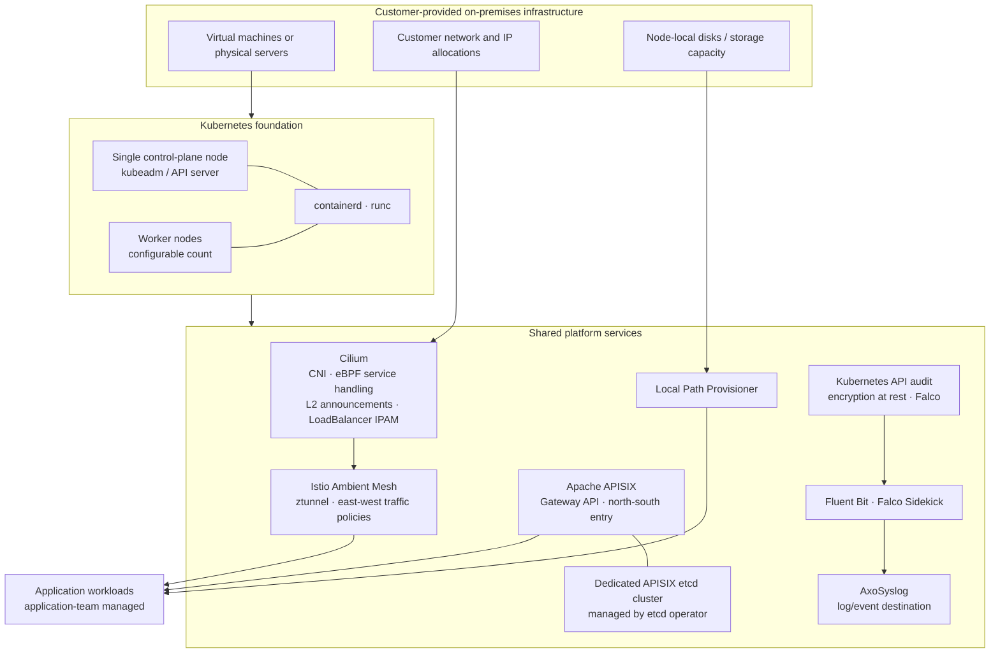
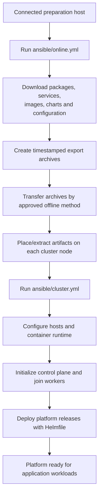

# Base Kubernetes Platform

An Ansible-driven, air-gapped Kubernetes platform reference implementation for customer-provided on-premises infrastructure.

This project automates the deployment of a foundational Kubernetes environment and a set of shared platform services. It is intended to give application teams a consistent platform for running workloads without requiring them to build and operate the cluster's networking, service-mesh, gateway, and baseline security foundations themselves.

The repository is both a working implementation and a reference that can be adapted to different on-premises environments. It is not a cloud-provisioning solution or a complete managed Kubernetes distribution.

> **Project status:** This is a demonstration/reference implementation. The current topology uses a single control-plane node. Review the limitations and security notes before using it outside a lab or evaluation environment.

## Contents

- [Goals and design principles](#goals-and-design-principles)
- [Architecture](#architecture)
- [Technology stack](#technology-stack)
- [Deployment model](#deployment-model)
- [Prerequisites](#prerequisites)
- [Configuration](#configuration)
- [Air-gapped preparation](#air-gapped-preparation)
- [Cluster deployment](#cluster-deployment)
- [Platform components](#platform-components)
- [Security and observability](#security-and-observability)
- [Application team responsibilities](#application-team-responsibilities)
- [Repository layout](#repository-layout)
- [Limitations and operational considerations](#limitations-and-operational-considerations)
- [Roadmap](#roadmap)
- [License](#license)

## Goals and design principles

The platform is designed for environments where the customer provides and administers the underlying infrastructure, while the platform operator is responsible for installing and configuring Kubernetes and its foundational services.

The main design goals are:

- **On-premises first:** deploy onto customer-provided virtual machines or servers without depending on a particular hypervisor or cloud provider.
- **Air-gapped deployment:** prepare required packages, binaries, charts, configuration, and container images on a connected preparation host, then transfer them into the isolated environment.
- **Infrastructure-aware configuration:** let the infrastructure administrator supply node addresses, network interfaces, address ranges, and other environment-specific values through Ansible inventory and configuration.
- **Reusable automation:** use Ansible for host and Kubernetes setup, and Helmfile to coordinate platform chart releases and their dependencies.
- **Clear ownership boundaries:** provide shared cluster capabilities while leaving application-specific deployment and lifecycle management to application teams.

### Scope

This repository automates the Kubernetes platform layer. It does not provision virtual machines, configure hypervisors, allocate customer networks, or provide a complete application delivery platform.

The customer is responsible for supplying the machines, network connectivity, IP allocations, and suitable underlying storage capacity.

## Architecture

The following diagram shows the logical layers and principal components.



The diagram is a logical overview rather than a packet-level topology. Actual traffic paths depend on workload enrollment and the corresponding Istio and gateway configuration.

### Network and traffic responsibilities

The platform uses separate components for different traffic concerns:

- **Cilium** provides pod networking, eBPF-based service handling, and Kubernetes `LoadBalancer` IP allocation. L2 announcements advertise allocated service addresses on the customer network.
- **Istio Ambient Mesh** provides the east-west service-mesh data plane using `ztunnel`. Workloads intended to receive mesh traffic controls must be enrolled in the mesh and governed by the applicable policies.
- **Apache APISIX** provides the north-south gateway and exposes applications through Kubernetes Gateway API resources.
- **APISIX etcd** is deployed as a separate etcd cluster and managed by an etcd operator. APISIX uses this external etcd rather than the etcd bundled with its chart.

APISIX-to-application traffic should reach workloads through the intended Ambient Mesh path when those workloads are enrolled. Routing directly to workloads outside the mesh bypasses mesh-level controls and is not the intended secure deployment model.

## Technology stack

| Area | Technology |
|---|---|
| Host and cluster automation | Ansible |
| Kubernetes bootstrap | Kubernetes, kubeadm |
| Container runtime | containerd, runc |
| Container tooling | nerdctl, crictl |
| Kubernetes networking | Cilium |
| Service mesh | Istio Ambient Mesh |
| Gateway and ingress | Apache APISIX, Kubernetes Gateway API |
| Gateway state store | etcd, etcd operator |
| Package and release orchestration | Helm, Helmfile |
| Local persistent volumes | Local Path Provisioner |
| Runtime threat detection | Falco |
| Log forwarding | Fluent Bit, Falco Sidekick |
| Log destination | AxoSyslog |
| Cluster CLI | kubectl, k9s |

Versions are maintained in the repository's Ansible variables, image definitions, Helmfile releases, and chart values. Consult those files for the exact versions used by a particular revision.

## Deployment model

Deployment has two distinct phases:

1. **Online preparation:** use a connected host to retrieve the artifacts needed by the target platform version and assemble them into export archives.
2. **Offline installation:** transfer those archives into the isolated environment, make them available to the cluster nodes, and run the Ansible cluster deployment.

The online preparation host is separate in purpose from the offline cluster. The Ansible control machine can run on a cluster manager or on a separate management host, provided it has the required SSH connectivity and dependencies.



## Prerequisites

### Operating system

- Ubuntu 24.04 on the target nodes.
- Required OS packages and supporting services are prepared as local artifacts for offline installation.

Ubuntu 24.04 is the supported baseline for this implementation. Changing the operating system requires validating package names, versions, installation behavior, and host configuration tasks.

### Infrastructure

The customer or infrastructure administrator must provide:

- One control-plane/manager node.
- One or more worker nodes.
- Network connectivity between nodes on the ports required by Kubernetes and the deployed platform components.
- SSH access from the Ansible execution host to all target nodes.
- Node IP addresses and interface details.
- Pod and Service CIDR allocations that do not conflict with existing customer networks.
- A reserved address range for Cilium LoadBalancer services.
- Node-local storage capacity for the Local Path Provisioner.

The current implementation has been tested on virtual machines. It is designed not to depend on a specific hypervisor, but deployments on physical servers or other environments should be validated.

### Ansible execution host

Ansible must be available on the machine used to execute the playbooks. That machine can be:

- The control-plane node, or
- A separate management VM or server.

The Ansible execution host needs SSH connectivity to the target nodes. The target nodes must be reachable on the required ports for the selected deployment topology.

## Configuration

Environment-specific settings belong in the Ansible inventory and project variables rather than being treated as universal defaults.

At a minimum, review and configure:

| Configuration area | Responsibility |
|---|---|
| Inventory hosts and groups | Identify the manager, workers, online preparation host, and Ansible connection details |
| Node IP addresses | Set the administrative and internal addresses supplied by the infrastructure administrator |
| Network interfaces | Select the interfaces used for cluster communication and Cilium |
| Pod CIDR | Choose a non-overlapping pod address range |
| Service CIDR | Choose a non-overlapping Kubernetes Service address range |
| Cilium LoadBalancer pool | Set the customer-reserved service address range |
| API endpoint | Configure the manager's internal address and API port |
| Storage node | Select the worker used for local-path storage |
| Artifact paths | Configure where archives are imported, extracted, and exported |

### Network interfaces

The administrator configures interface names and IP addresses in the inventory.

- In a dual-NIC environment, the internal interface/IP is used for Kubernetes API access, kubelet communication, node-to-node traffic, and Cilium.
- In a single-NIC environment, the same interface can be used for both administrative access and internal cluster communication.
- Cilium's device list and direct-routing device must match the selected network configuration.

The current API endpoint uses the manager's internal address on port `6446`. This is an intentional project configuration rather than the default Kubernetes API port `6443`. Worker nodes and Cilium use this endpoint.

The current design does not include a virtual IP or highly available API endpoint.

### Address planning

The infrastructure administrator must confirm that the configured Pod CIDR, Service CIDR, node networks, and LoadBalancer address pool do not overlap in a way that causes routing conflicts.

The Cilium LoadBalancer pool must be drawn from an address range reserved for this purpose on the customer network. Do not copy example or lab addresses into another environment without validating ownership and reachability.

## Air-gapped preparation

Run the online preparation playbook from the Ansible project directory on a host with access to the required upstream repositories and registries:

```bash
ansible-playbook -i inventory.yml online.yml
```

The playbook prepares the dependencies needed for offline deployment, including:

- Required APT packages.
- Supporting services and binaries.
- Container images.
- Helm charts.
- Helm-related configuration and other supporting files.

The image preparation tasks pull images by their configured SHA-256 digest, tag them with the expected image tags, and export them for offline import.

### Exported artifacts

The archive task creates a timestamped export directory. A representative output is:

```text
/tmp/export_<timestamp>/
├── apt.tgz
├── charts.tgz
├── configs.tgz
├── gpg.tgz
├── helm.tgz
├── images.tgz
└── services.tgz
```

The exact output path is configurable. The archive names represent the artifact groups collected by the preparation workflow.

Transfer the generated archives into the air-gapped environment using the customer's approved process, such as removable media or another controlled offline transfer mechanism.

The required artifact files must be made available at the configured import location on every target VM. The current workflow distributes the artifact set to all nodes rather than maintaining separate role-specific bundles.

> **Artifact integrity:** image retrieval is digest-pinned during online preparation. The current export workflow does not generate a separate checksum manifest for the `.tgz` archives. Verify transferred files using an approved external process if transfer-integrity verification is required.

## Cluster deployment

After transferring and placing the artifacts on the target nodes, run the cluster playbook:

```bash
ansible-playbook -i inventory.yml cluster.yml
```

The top-level playbook imports the following stages:

1. Common configuration for all cluster nodes.
2. Manager/control-plane configuration.
3. Worker configuration and cluster joining.
4. Platform runtime/deployment tasks.

The common node stage prepares the host, unpacks the artifacts, configures local package installation, and installs the container runtime and Kubernetes components.

The manager stage installs the required cluster tooling and initializes Kubernetes. Worker nodes join the cluster using a short-lived bootstrap token. The join workflow calculates the Kubernetes CA public-key hash, creates the temporary token, performs the join, waits for the node to become Ready, and revokes the token in its cleanup stage.

The platform deployment stage runs Helmfile to synchronize the platform releases and their declared dependencies.

### Redeployment behavior

The playbooks contain checks intended to avoid reinitializing an already initialized control plane or rejoining a worker that already has a kubelet configuration. Helmfile uses `sync` to reconcile the declared releases with the cluster.

This supports repeatable execution for the tasks covered by those checks. It should not be interpreted as a guarantee that every configuration change, upgrade, rollback, or partial failure is automatically safe. Validate changes and recovery procedures in a representative environment before applying them to important workloads.

## Platform components

### Cilium

Cilium provides the Kubernetes CNI and eBPF-based service handling. The current configuration includes:

- `kubeProxyReplacement: true`.
- Cluster-pool IPv4 IPAM using the configured Pod CIDR.
- L2 announcements.
- A customer-defined LoadBalancer IP pool.
- Explicit device and direct-routing interface configuration.

The LoadBalancer pool is intended to use addresses reserved by the customer for Kubernetes services.

### Istio Ambient Mesh

Istio is deployed using Ambient Mesh components, including `istiod`, `ztunnel`, and the Istio CNI integration.

Ambient Mesh is used for east-west workload traffic. Application namespaces/workloads must be enrolled to receive the intended mesh behavior and policy enforcement. The platform provides the mesh foundation; application teams remain responsible for configuring their application-specific policy requirements in coordination with the platform operator.

### Apache APISIX and Gateway API

APISIX provides the north-south gateway layer. Kubernetes Gateway API resources are used to define gateway and route configuration.

The APISIX deployment uses a separately managed etcd cluster. The repository includes custom Helm charts and release definitions for the APISIX namespace setup, etcd cluster, and Gateway API resources.

The APISIX gateway and controller are configured to participate in the Ambient Mesh. Application workloads should also be enrolled where mesh controls are required for gateway-to-workload traffic.

### Storage

The platform deploys Local Path Provisioner as a basic node-local persistent-volume option.

The designated storage worker and local storage path are configurable. The current lab uses `worker1`, but that is not a fixed requirement.

Local Path Provisioner is not distributed storage. It does not provide replication, shared storage across nodes, or a complete backup and disaster-recovery solution. Customers must provide an appropriate storage architecture and define their own backup, snapshot, retention, and recovery policies for important data.

### Security

The current baseline includes:

- Kubernetes API audit logging.
- Encryption at rest for Kubernetes API resources configured by the project.
- Falco runtime detection using upstream rules.
- Istio Ambient Mesh as the foundation for workload traffic controls.

These capabilities are a baseline, not a complete security program. Review the policies, encryption key handling, RBAC, network controls, and operational procedures against the requirements of each target environment.

### Logging and event forwarding

The current logging path uses:

- Fluent Bit for log forwarding.
- Falco Sidekick for Falco event forwarding.
- AxoSyslog as the configured destination.

AxoSyslog is a demonstration destination and can be replaced with another supported backend by adapting the relevant configuration. The repository does not currently provide a complete metrics, dashboard, or alerting stack.

## Application team responsibilities

The platform is intended to provide shared infrastructure capabilities so application teams can focus on their workloads.

| Platform responsibilities | Application team responsibilities |
|---|---|
| Kubernetes cluster foundation | Application Helm charts and manifests |
| Cluster networking and service IP allocation | Application databases and data services |
| Ambient Mesh foundation | Application-specific mesh enrollment and policies |
| APISIX/Gateway API foundation | Application routes and exposure requirements |
| Basic local-path storage capability | Application data persistence requirements |
| Baseline audit and runtime security components | Application secrets and application security configuration |
| Shared log/event forwarding foundation | Application monitoring configuration and lifecycle |

The customer remains responsible for the underlying infrastructure, network, storage capacity, and infrastructure-level backup and recovery strategy.

## Repository layout

```text
.
├── ansible/
│   ├── cluster.yml
│   ├── online.yml
│   ├── defaults/
│   ├── groups/
│   ├── handlers/
│   ├── tasks/
│   │   ├── 00-downloads/
│   │   ├── 10-foundations/
│   │   ├── 20-cri/
│   │   └── 30-k8s/
│   │       ├── 00-install/
│   │       ├── 01-utils/
│   │       ├── 02-security/
│   │       ├── 10-initialize/
│   │       └── 20-run/
│   ├── templates/
│   └── vars/
├── helm/
│   ├── charts/
│   ├── releases/
│   ├── values/
│   └── helmfile.yml
└── LICENSE
```

### `ansible/`

Contains the online artifact-preparation workflow and offline host/Kubernetes deployment automation.

- `online.yml` prepares dependencies on a connected host.
- `cluster.yml` is the offline cluster deployment entry point.
- `tasks/00-downloads/` retrieves packages, services, images, charts, and creates export archives.
- `tasks/10-foundations/` prepares the host and local package installation.
- `tasks/20-cri/` installs and configures container runtime components.
- `tasks/30-k8s/` installs Kubernetes components, initializes the control plane, joins workers, applies baseline security configuration, and invokes platform deployment tasks.
- `defaults/` and `vars/` contain configurable project and environment values.
- `templates/` contains generated configuration templates.

### `helm/`

Contains Helmfile release definitions, custom charts, and component values.

- `helmfile.yml` is the release orchestration entry point.
- `releases/` defines the platform release groups and their dependencies.
- `charts/` contains project-specific charts.
- `values/` contains component configuration and environment-specific templates.

## Limitations and operational considerations

The following limitations are important when evaluating or adapting this project:

- **Single control plane:** the current implementation deploys one control-plane node. It does not provide control-plane high availability.
- **No API VIP:** the API endpoint is currently tied to the configured manager address; a VIP-based endpoint has not been implemented.
- **Customer-provided infrastructure:** VM/server provisioning, hypervisor configuration, network allocation, and physical infrastructure lifecycle are outside the project.
- **Ubuntu baseline:** Ubuntu 24.04 is the supported OS baseline for this implementation.
- **Local storage only:** Local Path Provisioner is a basic node-local option, not a distributed or replicated storage system.
- **No complete observability stack:** metrics collection, dashboards, and alerting are not currently implemented.
- **No dedicated secrets-management integration:** secrets handling must be designed for the target environment; do not treat repository defaults as a production secrets store.
<!--- **No archive checksum manifest:** the export workflow does not currently create checksums for the generated archives.-->
- **Environment-specific validation:** network ranges, ports, interface names, security policy, storage behavior, and upstream artifact availability must be validated for each customer environment.

## Security notes

Before deploying or publishing a fork of this repository:

1. Do not commit real credentials, API keys, bootstrap tokens, or encryption keys.
2. Keep secret values outside ordinary tracked defaults. Use Ansible Vault or an approved secret-injection mechanism.
3. If credentials or encryption keys have ever been committed to a public repository, treat them as exposed: rotate or replace them and remove the sensitive material from Git history where appropriate.
4. Restrict administrative interfaces, including the APISIX Admin API, to explicitly trusted management sources. Do not expose administrative endpoints broadly.
5. Review Kubernetes audit policies, encryption-at-rest key management, RBAC, mesh policies, and Falco rules for the target environment.
6. Verify the provenance and integrity of artifacts and transferred archives according to the customer's supply-chain security requirements.

## Roadmap

Potential areas for future development include:

- Highly available control-plane topology and a stable VIP-based Kubernetes API endpoint.
- Metrics collection and dashboards.
- Alerting and notification integration.
<!--- Export archive checksums and offline transfer verification.-->
- Dedicated secrets-management integration and improved key lifecycle handling.
- Expanded storage integrations and documented backup/recovery patterns.
- More automated validation and testing across different on-premises network and virtualization environments.

These are planned or potential improvements, not claims about currently implemented functionality.

## License

See [LICENSE](LICENSE) for the license governing this project.
